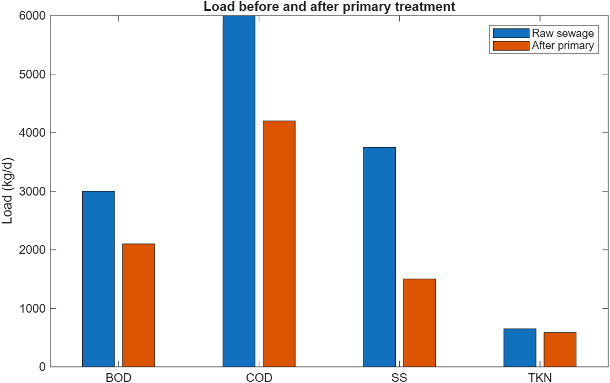
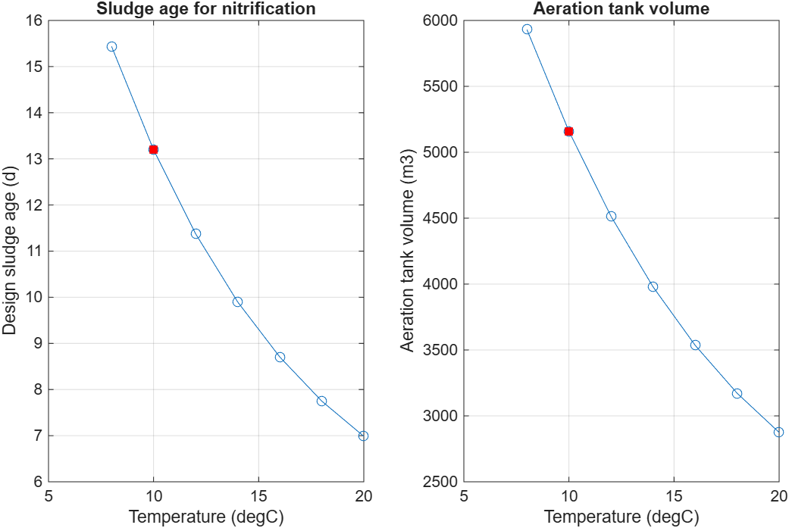
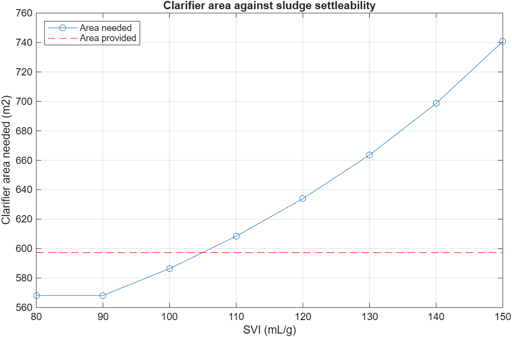
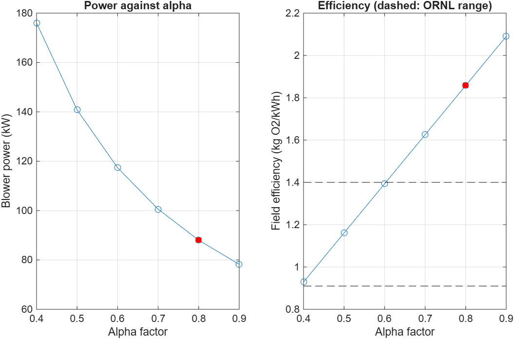

# Preliminary design of a 50,000 PE activated sludge works

A preliminary process design of a municipal wastewater treatment works for 50,000 population equivalent (PE), built as a learning project in Excel and MATLAB. It covers the design basis, inlet works and primary settlement, the aeration tank, the secondary clarifiers, and air supply and energy use.

This is a hand-calculation-level preliminary design based on textbook and guidance values. It is not site data and not a detailed design. The assumptions are listed in the workbook (Notes sheet) and the sources are on its Sources sheet.

## Status

Steps 1 to 5 are complete. Still to come: costing and whole-life cost.

## Contents

| File | What it does |
|---|---|
| `WWTW_Design.xlsx` | Design basis (inputs, flows, loads, required removals), notes on every parameter, and the sources list |
| `matlab/inlet_and_primary_sizing.m` | Screens, grit chamber and primary settlement tanks |
| `matlab/aeration_tank_design.m` | Sludge age, tank volume, sludge production and oxygen demand, with a temperature sweep |
| `matlab/secondary_clarifier_design.m` | Return sludge, clarifier area and a sludge settleability (SVI) sensitivity |
| `matlab/aeration_energy.m` | Air flow, blower power and annual energy, with an alpha factor sensitivity |
| `docs/` | Figures produced by the scripts |

## Design basis

- Population 50,000 PE, domestic flow only, 150 L/head/d plus 50 L/head/d infiltration
- Dry weather flow (DWF) 10,000 m³/d; flow to full treatment (FFT) 25,000 m³/d
- Raw load: BOD 3,000 kg/d (300 mg/L), SS 3,750 kg/d, TKN 650 kg N/d
- Consents: BOD 25, COD 125, SS 35 mg/L (EU Urban Waste Water Directive); ammonia-N 5 mg/L is an assumption
- Design temperature 10 °C (winter)

## Key results

| Stage | Result |
|---|---|
| Screens | 0.48 m² submerged area, clean headloss 0.033 m |
| Grit chamber | 52 m³ at FFT |
| Primary tanks | 2 × 13.0 m diameter, 3.2 m deep; overflow rate 38 / 94 m³/m²/d (DWF / FFT) |
| Load to aeration | BOD 2,100 kg/d, SS 1,500 kg/d, TKN 585 kg N/d |
| Aeration tank | 5,159 m³, sludge age 13.2 d, retention 12.4 h |
| Oxygen demand | 3,924 kg O₂/d |
| Clarifiers | 2 × 19.5 m diameter, 4.0 m deep; governed by solids loading at FFT |
| Air supply | about 4,000 m³/h, blower power about 88 kW |
| Energy | about 771 MWh/year for aeration, 15.4 kWh/PE/year |

## Limitations

- Design values are typical values from regulatory guidance, university course material and published design reports. Unsourced values are marked as assumptions in the workbook.
- The design is at average load. Installed blower capacity would need a peaking factor, and mixing, pumping and sludge treatment energy are not included.
- The base case aeration efficiency (1.86 kg O₂/kWh) is optimistic compared with field figures from the ORNL training material (about 0.9 to 1.4 kg O₂/kWh); it falls inside that range only when alpha is 0.6 or below. The sensitivity table and figure show this.
- The clarifier criteria come from one existing plant's design basis, not a standard, and UK practice has not been checked.
- The tanks work only up to an SVI of about 105 mL/g.
- Energy benchmarks are Australian data, not UK.

## Sources

Thirteen sources are listed with links on the Sources sheet of `WWTW_Design.xlsx`. They include the EU Urban Waste Water Directive, SEPA guidance, university lecture notes and published design reports.
